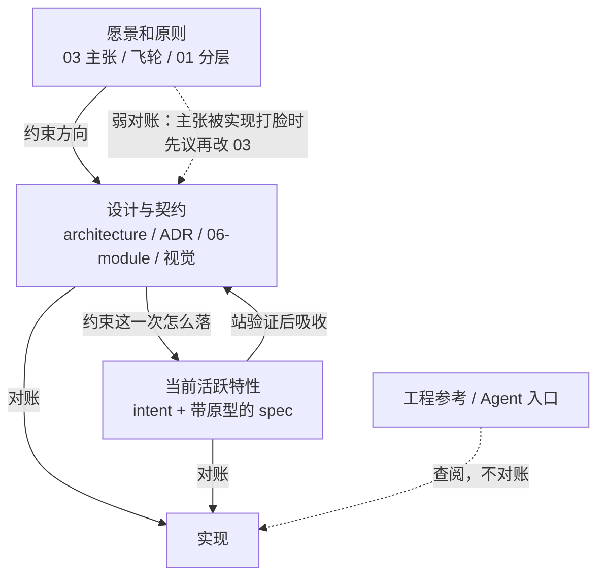
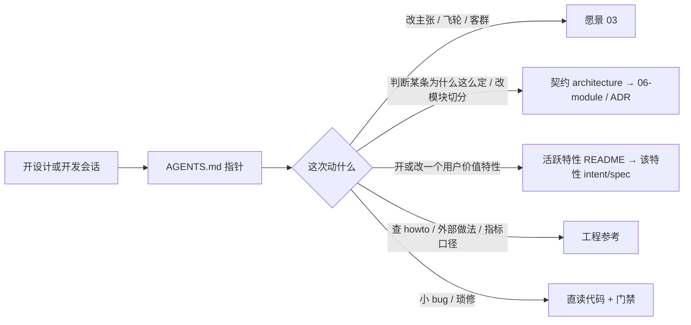

# 本仓文档 设计文档

## 1. 设计目的

Agent 每次开新会话，面前是一棵编过号的 `docs/` 树，但树本身不回答「这一次该读哪一层、哪一层可以拿来约束代码」。人记得原则慢变、特性走 `05-features/`、设计看 `architecture.md`；下一场窗口里的模型没有这段记忆。于是设计时把已交付特性的施工日记当成现行契约，开发时把新闻稿里的目标体验讲成已经落地的界面，或者把整棵 `docs/05-features/` 塞进上下文。

Workbench 知识库已经用一套跨仓稳定的**文档角色**给文档分组：路径因仓而异，角色与维护策略跨仓一致。本仓自己必须成为这套角色的实例，让下一场会话按角色加载，而不是按目录名猜测。这是对已有分层的一次视图建模——不另起目录、不重写主张与架构正文。设计基线是分支 `docs/native-session-execution`、revision `af5b7a0b`（2026-09-17）。

要做成的是：Agent 开设计或开发工作时，能在四步内落到正确正本——**愿景、架构契约、当前活跃特性、工程参考**——并且知道哪一层拿来对账、哪一层只查阅。不把已交付特性的施工过程再抄一份「现行设计」，不把 `AGENTS.md` 写成第二份架构，不把路径白名单写进运行时代码。

## 2. 设计逻辑

本仓文档要同时服务人和 Agent。人需要知道 gate 批哪份文件；Agent 需要知道「现在这次任务，哪一份是约束、哪一份是查阅、哪一份已经过期」。把这两件事绑在同一组角色上，路径映射单独放进地图，这样改目录不必改角色，改角色不必改加载协议。

### 2.1 稳定的是角色，可变的是路径

Agent 不能靠「这个仓的 `docs/05-features/` 就是特性」来工作，因为下一个被管仓可能把同样的东西放在 `docs/features/` 或 `cloud/docs/`。跨仓不变的是这份文档**干什么**：给访客看、给人拍板的为什么、难回头的约定、正在推进的特性、实现时查阅的 howto。这些「干什么」就是文档角色。本仓的路径只是角色在这个仓库里的落点，写在 `.bw/knowledge-map.toml`，不写进原则正文。

八个角色如下。用户文档不对账；工程侧只有契约和当前活跃特性对账。

| 角色 | 名称 | 回答什么 | 本仓主要落点 | 对账 |
|---|---|---|---|---|
| `user-docs` | 产品帮助 | 人怎么用、点什么得到什么 | `docs/03-guide/` | 否 |
| `user-readme` | 对外 README | 访客第一眼：是什么、怎么跑起来 | `README.md` | 否 |
| `eng-principles` | 愿景和原则 | 客群、主张、飞轮、知识怎么分层 | `docs/01-principles/` | 弱 |
| `eng-contract` | 设计与契约 | 旅程、逻辑模块、难回头决定、视觉与模块心智 | `docs/architecture.md`、`docs/02-adr/`、`docs/04-design-system/`、`docs/06-module/`、`docs/hifi/` | **是** |
| `eng-features` | 当前活跃特性 | 正在推进、尚未被契约吸收的 intent / spec | `docs/05-features/README.md` 列出的目录 | **是** |
| `eng-reference` | 工程参考 | howto、外部提炼、指标口径备忘 | `docs/10-reference/`、`docs/metrics.md` | 否 |
| `eng-agents` | Agent 入口 | 怎么建/跑/测、用哪个词、会话地板 | `AGENTS.md`、`CLAUDE.md`、`CONTEXT.md` | 否 |
| `eng-bw` | 项目约定 | 名片、知识地图 | `.bw/project.toml`、`.bw/knowledge-map.toml` | 否 |

用户点名要能包含的四块，对应其中四条工程主路径：愿景是 `eng-principles`（主张正文在 03），架构设计是 `eng-contract`，活跃特性设计是 `eng-features`，工程参考是 `eng-reference`。另外四条（产品帮助、对外 README、Agent 入口、项目约定）同样是角色，只是日常设计/开发时按需加载，不进对账主线。

上面的表达中我们引入了如下概念：

* **文档角色**：一份文档在 AI-native 项目里承担的稳定职责，与它落在哪个目录无关。
* **知识地图**：把本仓路径映到文档角色的机器可读表，正本是 `.bw/knowledge-map.toml`。
* **当前活跃特性**：已经立项、尚未把约束吸收进契约的特性。`docs/05-features/` 目录可以留下史，但角色集合只含活跃的那些。
* **对账**：拿契约或当前活跃特性的正本对照实现。对不上就改实现，或提交给人改设计；不把现状写回正本。

### 2.2 约束链：愿景管方向，契约管结构，活跃特性管这一次

Agent 改代码时最容易犯的错，是把三层约束摊成同一层「文档里好像都写过」。愿景回答为什么做、飞轮允许加强哪一截；契约回答系统现在怎么切、哪条铁律不能破；活跃特性回答这一次要给用户什么新价值、规格长什么样。三者单向约束：特性 intent 不得改写 03 的主张，实现不得绕过 `architecture.md` 已作数的切分去另开通道。



特性交付之后，它留下的不是永远占据 `eng-features` 槽位的一叠施工文件。对实现仍有约束的那些句子，写进 `architecture.md` 或对应的 `06-module/`；`STATUS` 标已实现或已拒绝后，这条特性退出活跃集。知识地图和 [`docs/05-features/README.md`](../05-features/README.md) 同步更新。目录可以留着当史，Agent 默认不加载。

### 2.3 Agent 按需加载，不按树遍历

`AGENTS.md` 是每场会话都在的地板，它只做指针：点明角色、点明本仓落点、点明何时去读正文。愿景、契约、活跃特性、工程参考的正文都在指针后面，只有对应分支才加载。



加载时有三条硬规则。第一，03 写的是目标体验，现行做到哪听 `architecture.md`，不得把草稿界面讲成已经交付。第二，对账只盯契约和当前活跃特性；参考、指南、Agent 入口不对账。第三，找不到落点时先补文档再动代码——不清晰不写代码，这一条已经写在 `AGENTS.md`，本设计只是给它补上「补哪一层」：缺的是主张就回到 03，缺的是结构就回到 architecture / 06-module，缺的是这一次的规格就开 `05-features/<id>/`。

## 3. 核心数据结构

文档系统围着两张表转：一张把路径映到角色，一张把 `05-features/` 里的目录滤成当前活跃集。Agent 先读表，再读正文。

知识地图是角色到路径的适配。`status` 区分草稿（接入时启发式生成）和已审（人确认过映射）。冲突时更长、更精确的 path 优先；exclude 优先于 section。

```toml
version = 1
status = "reviewed"

[[section]]
role = "eng-features"
paths = ["docs/05-features/README.md", "docs/05-features/<active-id>/"]

[[exclude]]
paths = ["docs/draft/"]
```

活跃特性索引是人可读的同一份过滤。一条特性至少有 `id`、`STATUS`（draft / accepted / building / in_review / shipped / rejected）、intent、带原型链接的 spec。`STATUS` 为 shipped 或 rejected 的条目不进索引、不进地图的 `eng-features` section。本仓现行活跃集写在 [`docs/05-features/README.md`](../05-features/README.md)，地图只列出索引里的那些目录。

两张表的关系：地图告诉知识库和 Agent「哪些路径属于哪个角色」；索引告诉人和 Agent「`eng-features` 这一角色此刻有哪几条」。改其中一张而不改另一张，活跃集就会说谎。

## 4. 接口定义

人继续走 01 已经定下的 gate：特性级变更批 `intent.md` 和带原型的 `spec.md`，`plan.md` 仅大风险升 gate，小修直修。本设计不另开一道文档 gate。它补上的是 Agent 侧的读写口——角色怎么被找到、活跃集怎么被更新、一场会话从哪份文件开始。

```text
# 知识地图：路径 → 角色。接入或目录重组后审阅，status 改为 reviewed。
.bw/knowledge-map.toml

# 活跃特性索引：此刻对账主线里的特性。STATUS 变为 shipped/rejected 时从这里拿掉。
docs/05-features/README.md

# 会话地板：角色指针。改落点时改这一段，不把正文抄进来。
AGENTS.md 「文档角色」
```

Agent 开一场设计或开发，先读 `AGENTS.md` 的角色指针，再按 2.3 的分支加载正文。要判断「某条为什么这么定」，读契约：`docs/architecture.md` 看旅程和逻辑模块，需要取舍时再进 `docs/06-module/`，难回头的决定进 `docs/02-adr/`。要开或改一个用户价值特性，先读活跃索引，没有对应条目再按 02 新建 `docs/05-features/<id>/`。要查命令、门禁、铁律，留在 `AGENTS.md`，不要到 architecture 里找构建步骤。

人交付一个特性之后，维护者（人或 Agent）做三件事：把仍约束实现的句子写入契约；把 `STATUS` 标成 shipped 或 rejected；从活跃索引和知识地图的 `eng-features` section 里拿掉这条路径。这三件事构成一次吸收，缺任何一件，下一场会话仍会把施工日记当成现行设计。

## 5. 变更历史

| 日期 | 变更原因和内容 |
|---|---|
| 2026-09-17 | 首篇：用文档角色给本仓已有分层建模，让 Agent 按愿景 / 契约 / 活跃特性 / 工程参考加载；知识地图与活跃索引作为机器接口 |
