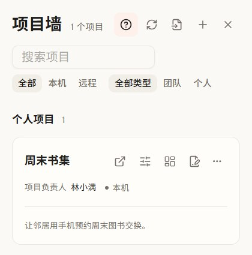
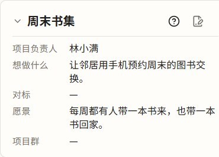
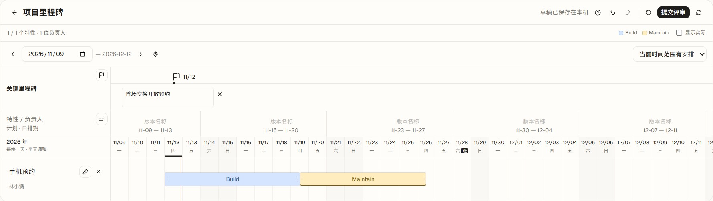
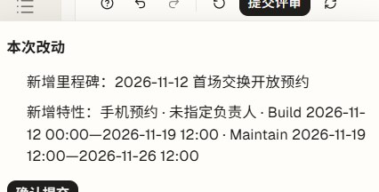

# 从产品想法到共同方向和阶段安排

> **使用与维护** · 给一起做项目的 2–3 人团队。用项目名片写清方向，用里程碑约定阶段成果。BW 界面或保存方式变化时，同步更新本页、截图和[引导矩阵](../../04-design-system/guidance.md)。

## 开始前

将 Git 项目纳入 BW。团队要通过评审共享正式结果时，需要连接项目仓的 GitHub 或 CodeHub 远端，团队成员需要能访问同一仓库。示例「周末书集」使用隔离的本机 Git 仓，负责人和内容为演示数据。

## 找到项目

点击左侧「项目墙」，按名称搜索。来源和类型筛选会一起生效。搜索无结果时点「清除搜索和筛选」找回项目。点击项目名称继续工作；要讨论方向和排期，点该卡片的「项目总览」图标。

## 写下共同方向

展开项目名片，查看负责人、「想做什么」和「愿景」。点击「编辑项目信息」打开项目设置，在同一表单更新这些字段。先核对变更，再确认。本机无远端的 Git 仓可以「保存」，关闭设置后展开名片即可读回。配置了远端的仓库走「提交评审」，后续在项目设置中查看评审或更新已合入的名片。

名片记录方向和负责人，里程碑安排阶段成果和日期，记分牌展示实际指标。讨论方向时可以直接开始规划。

## 安排阶段成果

在总览的「项目里程碑」点「规划里程碑」。点击旗帜「添加里程碑」，选择日期并填写一句可验收的预期成果，例如「首场交换开放预约」。点击「添加特性」，写明支撑成果的特性，例如「手机预约」。拖动 Build 条身调整起止日期，拖两端调整时长，也可聚焦端点用方向键微调。

看到「草稿已保存在本机」后，可以用返回箭头退出编辑。普通视图显示正式安排，点「继续规划」找回草稿。需要时用里程碑问号重看操作提示。

## 核对变更和回看结果

点「提交评审」先打开改动摘要。项目仓已连接且有权限时，可以确认提交，由队友在代码托管平台评审。已提交的提案可用「查看评审」打开。队友合入后，按对应提示点「更新正式安排」或「更新代码」，回到总览查看正式排期。名片用「更新项目信息」读回。这个流程适用于能提交项目材料的仓库。

这张摘要取自填写特性负责人之前，确认时以当前弹窗列出的内容为准。

| 遇到的情况 | 怎样继续 |
| --- | --- |
| 项目墙找不到项目 | 清除搜索和筛选。若项目在远程主机，先恢复连接，再刷新项目墙。 |
| 名片仍未提交 | 留在设置栏重试。退出前核对是否还有未提交的输入。 |
| 里程碑评审状态读不到 | 点「刷新里程碑与评审」，待状态读到后再提交。 |
| 未确认项目仓远端身份 | 本机草稿仍在。配置受支持的远端或恢复连接，刷新后点「重试提交」。 |
| 总览仍显示上次正式排期 | 核对评审是否已由队友合入，再更新正式安排。用「继续规划」查看自己的草稿。 |

产品内可以从左下角「帮助 → 探索 BW → 工作旅程 → 明确方向」回看四步动画。项目墙、总览名片和里程碑的问号打开当前屏幕的操作引导。[查看旅程长图](journey.jpg) · [编辑长图源](journey.html)

**适用证据** · Windows BW 开发版（Electron 43.7.0）以 #635 合入的主干为基线，在本机演示 Git 仓实走项目墙、名片保存与读回、里程碑本机草稿、变更摘要和提交失败恢复。远端评审、合入后的更新和多设备读回依据现行规格，待使用有权限的共享仓验证。详见[名片规格](../../05-features/project-intake/spec.md#项目信息编辑与失败反馈)和[里程碑规格](../../05-features/overview-metrics/spec.md#编辑历史提交与正式来源)。
