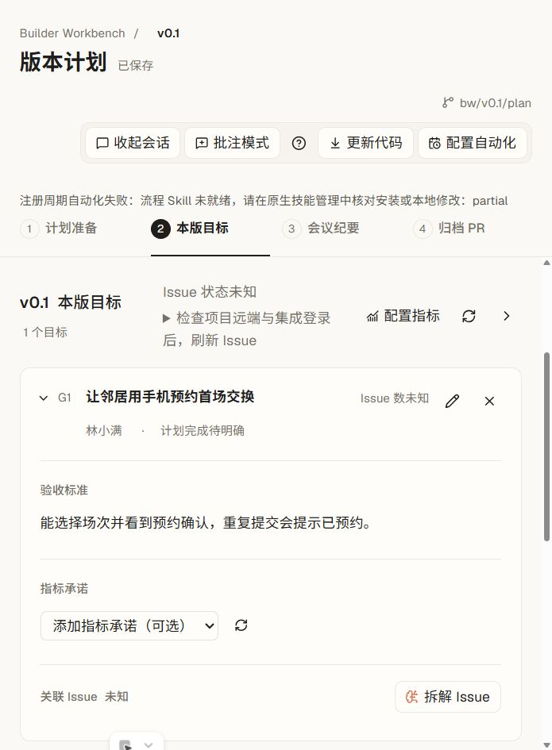

# 从项目方向制定版本计划

> **使用与维护** · 给准备首版或续版的 Builder 和评审者。计划入口、任务关联或归档方式变化时同步本页及[引导矩阵](../../04-design-system/guidance.md#探索-bw-矩阵)。

从左下角「帮助 → 探索 BW → 工作旅程 → 制定版本计划」看五步演示。可以直接选一步，也可以顺序播放、暂停或从头重播。演示使用样例「周末书集」，没有项目也可以看。

## 确定这次规划哪一版

打开已纳入 BW 的 Git 项目。需要参考方向和排期时，先看[项目总览的名片与里程碑](../project-direction/README.md)。从「版本工作区」展开对应版本，点「计划」。首版点「新建版本」。如果只在里程碑预排过，填写同一版本名。创建后会打开本版计划工作区。

点「开始计划」，在原生会话中核对预填请求、补充要求并发送。有计划材料时，回到同版「计划」就能继续查看与编辑。无绑定工作区的历史版本可只读回看。计划准备区显示上版延期和会议遗留。首版显示「暂无上版」，上版缺验收时回顾暂空，两种情况都可继续。

## 定目标与验收标准

用一句话写下团队准备交付的结果，再写评审时要核对的现象。例如「让邻居用手机预约首场交换」，验收标准可以是「能选择场次并看到预约确认，重复提交会提示已预约」。展开目标，点「编辑目标」直接修改。页头「已保存」表示当前工作区的材料已写入。关闭编辑、切屏或重新打开后，可以在同一目标中读回。

## 协作操作参考

- 用目标卡的「拆解 Issue」请助手先查已有任务。确认纳入范围后，计划屏按版本标签和标题目标段读回。任务标题打开原生详情，返回可继续计划。已有版本标签而标题目标段无法匹配时，到「未归类」核对。
- 与队友核对目标和任务，直接修改或用「批注模式」记意见。需要纪要时点「整理纪要」，核对共识和遗留后由人标记确认。
- 在计划会话中要求归档，归档卡从托管平台读回已登记的 PR/MR 状态。请队友评审合入，再从版本总览回看正式材料。任务行的「开工」可打开已有工作区，或把该 Issue 预填到原生创建器。

上述协作路径按现有产品入口说明，本轮实走覆盖见文末。需要可用的模型会话及项目对应的 GitHub 或 CodeHub 账号和权限。真实归档、Issue 开工和队友读回的本轮验证状态见[版本计划状态](../../05-features/version-planning/STATUS.md)。

## 遇到问题时

| 看到什么 | 怎样继续 |
| --- | --- |
| 只有里程碑排期 | 回到「版本工作区 → 新建版本」，填写排期中的版本名。 |
| 计划会话没有开始 | 先核对已有会话与输入区。按屏上提示检查默认智能体、Skill 安装或冲突，再回到同版计划重试。 |
| 保存失败或有冲突 | 当前输入仍在。用「重试保存」，或展开比较当前输入与文件内容后选择采用哪份。 |
| Issue 状态未知 | 检查项目远端及「设置 → 集成」中的对应登录，回到目标区点「刷新 Issue」。 |
| PR/MR 状态未知或主干还没读到 | 先核对托管平台上的评审和合入，再按需要「更新代码」。 |

屏内可从计划页头「版本计划帮助」、侧栏「版本工作区帮助」和任务页「任务帮助」重播操作引导。探索中相应功能也可点「在界面中跟做」。

**本轮实走范围** · Windows Electron 隔离 Git 项目验证了新建首版和续版、首版无上版、返回首版、编辑验收标准、文件读回与渲染进程重载。产品内动画与业务实走各自记录。截图为演示项目真实计划屏，任务源未连接。
